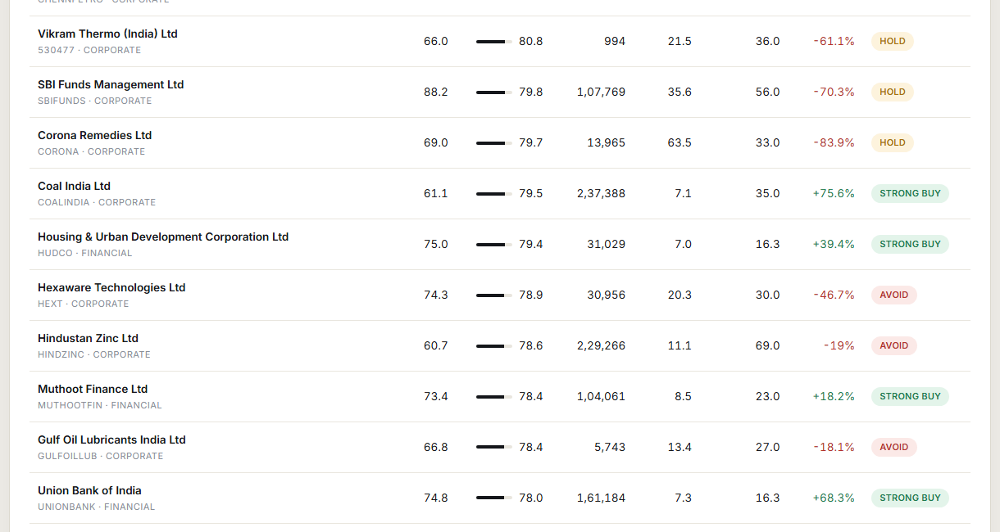

# Promoter Pro

**A promoter-led screener for Indian equities. It reads the full set of published fundamentals for every listed company, scores six pillars, and answers one question: buy, hold, or avoid — and why.**


---

## The idea

Promoter holding is the cheapest honest signal in the market. When the owners still own **60%+** of the business, everything else — debt, margins, cash conversion, growth — is worth reading. Below that gate, nothing else counts.

So the tool starts there, then refuses to be impressed by a single good year.

## What it does

- **Screens the whole exchange.** 7,633 listed symbols indexed, 2,700+ company pages read so far: balance sheet, profit & loss, cash flow, ratios and the quarterly shareholding table.
- **Scores six weighted pillars** — promoter conviction, balance sheet, profitability, growth, cash generation, valuation — out of 100, with a confidence figure that drops when a pillar has no data instead of quietly re-weighting it away.
- **Vetoes, not just grades.** Hard red flags (pledging, promoter selling, chronic losses, a stale or implausible multiple, a cycle-peak earnings year) force `AVOID` no matter how good the score looks.
- **Prices the business, then judges the price.** A required-return hurdle built from a 10-year G-Sec plus an equity premium, adjusted for through-cycle returns, growth, leverage and owner stake, gives a justified P/E. For lenders it switches to a clamped Gordon P/B. A verdict can never contradict the valuation column it prints — an expensive good business is capped to `HOLD`.
- **Searches anything, instantly.** Type any symbol — `INA`, `UNIPARTS` — and the page is read on demand if the crawl has not reached it yet.
- **Exports the screen to CSV** with every column, including the fair-value range and the red flags that fired.



## Reading one company

Every row opens a drawer with the full arithmetic, not just a verdict:

- the modelled value range and how far the market sits from it,
- the **P/E and fair-value breakdown** — each ± point off the hurdle rate, whether the floor was applied, justified versus current multiple,
- a **six-year EPS ladder** showing today's price against each year's earnings, so you can see whether the multiple is falling because profit grew or because the price did,
- ten years of balance sheet, P&L and cash-flow tables, plus the quarterly shareholding history.

## Verdict ladder

| Score | Verdict | Gate |
|---|---|---|
| ≥ 78 | `STRONG BUY` | also needs the valuation pillar ≥ 60 |
| ≥ 68 | `BUY` | |
| ≥ 55 | `HOLD` | |
| < 55 | `AVOID` | |
| any severe red flag | `AVOID` | overrides the score |
| valuation pillar < 35 **or** 40%+ above fair value | capped to `HOLD` | overrides `BUY` |

Current distribution across 197 companies with promoter ≥ 60% and market cap ≥ ₹500 Cr: **5 STRONG BUY · 5 BUY · 83 HOLD · 104 AVOID.** Most businesses fail the price test, which is the point.

## Quickstart

Python 3.11+, standard library only — no pip install, no API key.

```bash
git clone https://github.com/85599/promoter-pro.git
cd promoter-pro

python -m promoterpro universe          # index every listed symbol
python -m promoterpro scrape            # read company pages, resumable
python -m promoterpro report            # top promoter-led ideas in the terminal
python -m promoterpro serve --port 8757 # dashboard at http://127.0.0.1:8757/
```

The crawl is resumable: state lives in a local SQLite file, so you can stop it, reboot, and pick up where it left off.

**This is a research tool, not investment advice.** It has not been backtested against realised returns and no accuracy figure is claimed anywhere in it.

## Licence

MIT.
